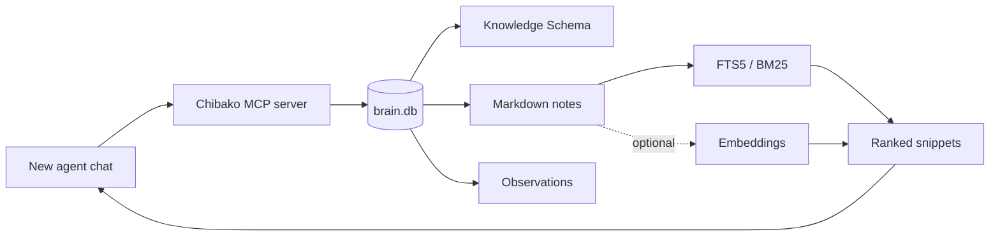
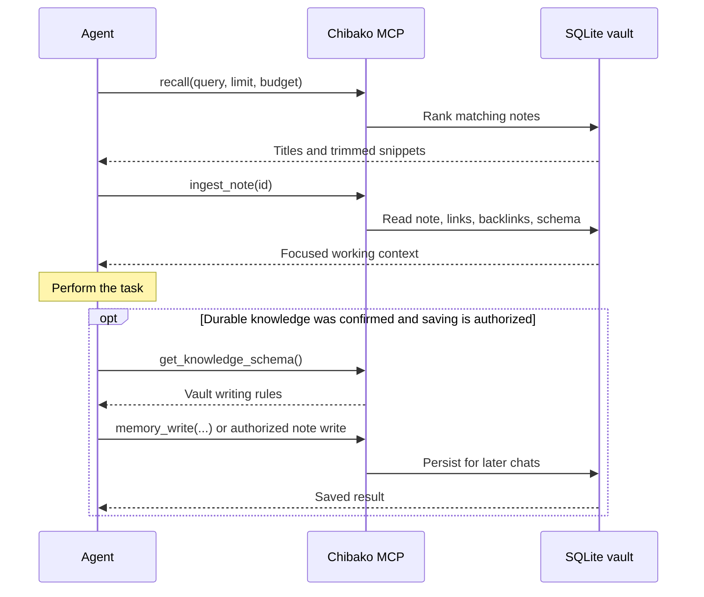
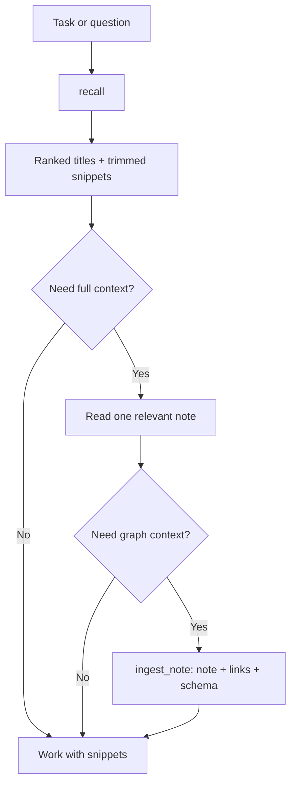

# Agent memory in Chibako

Chibako gives AI agents durable, shared memory without putting the whole vault
into every prompt. Notes remain human-readable Markdown, while MCP provides a
small retrieval path: discover first, load only what the task needs, then save
confirmed knowledge when authorized.

## How it works

The chat itself is not copied into Chibako. Memory becomes reusable only when
an agent or person saves a note or observation. A later chat can access it when
its MCP connection points to the same `brain.db` vault.

The three stored forms have different jobs:

| Stored data | Purpose | How an agent reads it |
|---|---|---|
| Knowledge Schema | Vault-specific rules for naming, linking, properties, and compilation | `get_knowledge_schema` or `ingest_note` |
| Notes | Canonical, substantial knowledge in Markdown | `recall`, `search_notes`, `read_note`, `ingest_note` |
| Observations | Short decisions, preferences, and lessons | `list_observations` |

## A typical session

The installable [`chibako-memory`](../skills/chibako-memory/SKILL.md) skill
teaches compatible agents this workflow. The standalone skill requires a configured
Chibako MCP connection. The automatic plugin bundles this skill,
`chibako-memory-setup`, and the explicit-only
[`chibako-memory-cleanup`](../skills/chibako-memory-cleanup/SKILL.md), plus lifecycle
hooks. Cleanup reviews old memory within a user-selected scope and applies
authorized changes; lifecycle hooks never invoke it. Follow the
[installation guide](../integrations/agent-memory/INSTALL.md) to connect it.

## Automatic memory with hooks

For Codex, Claude Code and Hermes, the
[hook plugins](../integrations/agent-memory/README.md) make memory automatic
while keeping its cost low:

- **Session start:** one capped read of the shared "Now" overview (about 450
  tokens), a one-time short instruction, and `recall` on the first prompt. The
  Knowledge Schema is fetched only when a save is due.
- **Activity gate:** hooks count user turns and tool calls locally. Trivial
  sessions cost nothing extra. After 4 user turns or 10 tool calls since the
  last save (configurable per profile), the agent is asked once to save.
- **Thread-centric saves:** the agent saves one overview note per thread plus a
  short status line. The runner upserts `- [[Thread]] — status` into "Now"
  (newest first, at most 15 lines), so the next session in any runtime knows
  where work stopped.

## Why retrieval uses fewer context tokens

Chibako uses progressive disclosure. An agent can move from a small index to a
bounded set of snippets and read a full note only after finding a relevant one.

Evidence in the implementation:

- [`list_notes`](../src/mcp/server.ts#L89) returns note metadata instead of
  note bodies. [`get_links`](../src/mcp/server.ts#L194) returns compact link
  targets and backlink identities.
- [`recall`](../src/lib/recall.ts#L107) always ranks candidates with SQLite
  full-text search and returns titles plus trimmed snippets. Recall matches
  any query term, so natural sentences find notes. If embeddings are
  configured, it fuses vector and keyword rankings, weighting keywords at half
  so they boost semantic matches rather than displace them; otherwise it stays
  local and uses BM25 alone.
- The caller supplies a retrieval budget. Chibako estimates token use from
  character count and stops adding results near that budget
  ([implementation](../src/lib/recall.ts#L140),
  [test](../tests/recall/recall.test.ts#L7)).
- [`ingest_note`](../src/mcp/server.ts#L311) combines a note, its outlinks,
  backlinks, and the Knowledge Schema in one MCP call. This saves round trips;
  its full note body can still be large.

The token budget is approximate. Chibako currently estimates tokens with
`characters / 4`, trims snippets by words, and may return the first result even
when it exceeds the requested budget. Claims such as “exact token cap” or a
specific percentage saved would require tokenizer-based measurements and a
repeatable benchmark. The supported claim is: **Chibako lets callers target a
context budget and avoids loading full note bodies during discovery.**

## Access and ownership

Chibako stores notes, links, settings, observations, search data, and optional
embeddings in one SQLite vault. API keys are hashed, revocable, and scoped. A
read-only agent can receive `notes:read`, `search:read`, and `schema:read`; add
`notes:write` only when that agent should save knowledge.

Remote MCP is available at `/mcp` on the Chibako HTTPS origin and requires a
scoped bearer API key. It is stateless: each request gets an isolated server
and tool catalog. Remote agents cannot trigger embedding indexing, and
permanent deletion requires `notes:purge`.

Local stdio remains available through `dist/mcp/server.mjs`. It reads the same
`CHIBAKO_DATA_DIR` as the web application and has full local access when no API
key is configured. See [Connect your AI agent](../README.md#-connect-your-ai-agent)
for both configurations. Chibako API keys are not an OAuth implementation.

## Current limits

- Chibako does not automatically capture chat transcripts.
- `recall` searches notes; observations are retrieved separately and currently
  have no query filter.
- Token budgeting is estimated rather than tokenizer-enforced.
- Semantic recall needs an OpenAI-compatible embedding provider; keyword recall
  works without one.
- Chibako has no published cross-product token benchmark yet.
