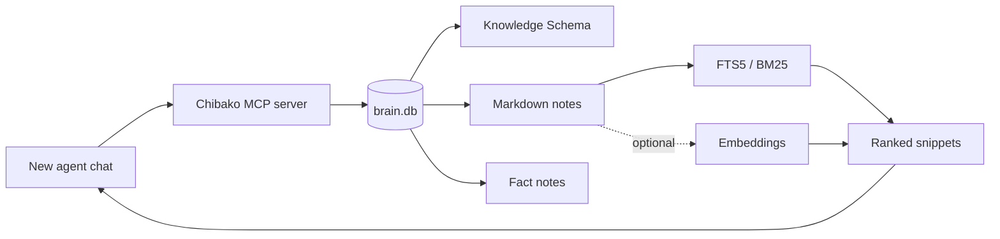
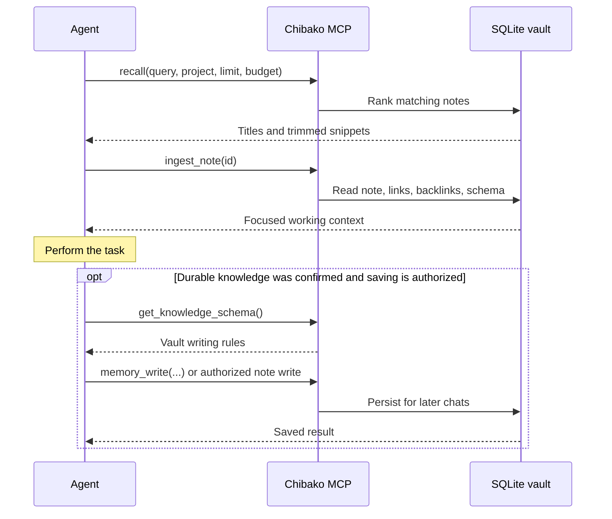
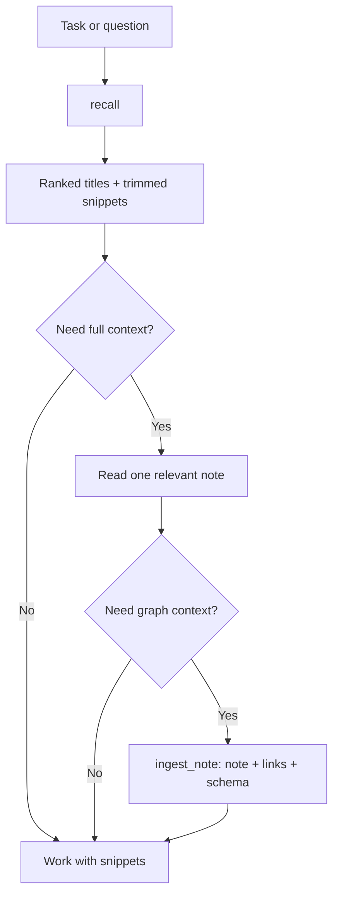

# Agent memory in Chibako

Chibako gives AI agents durable, shared memory without putting the whole vault
into every prompt. Notes remain human-readable Markdown, while MCP provides a
small retrieval path: discover first, load only what the task needs, then save
confirmed knowledge when authorized.

## How it works



The chat itself is not copied into Chibako. Reusable knowledge comes from saved
notes and Fact notes; hooks can also save a bounded metadata-only Activity
record. A later chat can access it when its MCP connection points to the same
`brain.db` vault.

The three stored forms have different jobs:

| Stored data | Purpose | How an agent reads it |
|---|---|---|
| Knowledge Schema | Vault-specific rules for naming, linking, properties, and compilation | `get_knowledge_schema` or `ingest_note` |
| Notes | Canonical, substantial knowledge in Markdown | `recall`, `search_notes`, `read_note`, `ingest_note` |
| Fact notes | Short decisions, preferences, and lessons saved with `memory_save` (ordinary Notes in the memory folder) | `recall`, `search_notes`, `read_note` |

## A typical session



The installable [`chibako-memory`](../skills/chibako-memory/SKILL.md) skill
teaches compatible agents this workflow. The standalone skill requires a configured
Chibako MCP connection. The automatic plugin bundles this skill,
`chibako-memory-setup`, and the explicit-only
[`chibako-memory-cleanup`](../skills/chibako-memory-cleanup/SKILL.md), plus lifecycle
hooks. Cleanup reviews old memory within a user-selected scope and applies
authorized changes, including `delete_folder` for folders it emptied; lifecycle
hooks never invoke it. Follow the
[installation guide](../integrations/agent-memory/INSTALL.md) to connect it.

## Automatic memory with hooks

For Codex, Claude Code and Hermes, the
[hook plugins](../integrations/agent-memory/README.md) make memory automatic
while keeping its cost low:

- **One folder rule:** checkpoints, Activity and retained agent facts stay under
  `<memory area>/<project>`. Reader-facing notes reuse the existing project/topic
  branch found by search, with properties from `get_property_defs` and a wikilink
  to the project overview. A new top-level folder needs a user request.
- **Thread resume:** when `T3CODE_THREAD_ID` reaches the hook, the runner sends
  `thread_key = sha256("t3:" + id)`, never the raw identifier. Under the same
  API-key principal, model/runtime switches within that thread resolve the same
  checkpoint. Server lookup order is session link, thread link, session record,
  then (save only, when none exists) workstream title match.
- **Plain titles and workstreams:** the first task title stays stable, without an
  added session suffix. A first save can join a checkpoint with the same title in
  the same project, ignoring case, repeated whitespace and trailing legacy
  `(runtime-hex)` suffixes. Open records (including stale ones) win over finished
  records; the newest update wins within each group. Trashed records are excluded.
  An unread match returns `revision_conflict` naming the target and revision,
  without linking or writing. Read that note by title, merge, and retry with the
  revision. For a staged conflict, omit `request_id` and include the pending
  `replaces_request_id` supplied by recovery. A successful match can reopen a
  finished workstream. A title collision with an ordinary Note still needs a new title.
- **Session start:** a linked checkpoint's revision and up to 1,500 characters of
  content can precede the capped Agent Now read (current project first, about 500
  tokens). Read the note by title for the rest; a direct MCP session read without
  the thread key cannot resolve a thread-only link. First-prompt recall adds
  relevant snippets. Checkpoint prompts need no Knowledge Schema; fetch it before
  retention or general Note writes.
- **Save gate:** defaults are 10 tool calls for Codex (chat turns alone never
  qualify), or 4 user turns or 10 tool calls for other hosts. Profile thresholds
  can override those counts. One reminder requests a checkpoint; save/skip/finish
  resets the counts. Task changes update the same session checkpoint.
- **Shared handoffs:** explicitly stage `{"continue":{"title":"<entry title>"}}`
  to join a known checkpoint, including one in another thread. Read and merge its
  returned content/revision. A session with another active checkpoint must finish
  it first. Revision checks protect concurrent contributions.
- **Agent Now:** one index at the area root keeps at most 15 entries, newest saves
  first: `- [[Agent Memory/project/Title]] (project) — next action · YYYY-MM-DD`.
  Entries use folder-qualified links; older plain links still parse. Earlier per-project
  Now indexes are folded into it on the next save; fully migrated ones go to Trash.
- **Activity capture:** hooks record metadata when at least three tool calls have
  accumulated since the last save, skip, finish or capture and nothing is pending.
  Claude captures at Stop and SessionEnd, Codex at Stop, and Hermes at `pre_verify`
  (mapped to Stop). A Stop asking for a checkpoint defers capture. SessionEnd also
  flushes pending data and never finishes a checkpoint; Hermes `on_session_end`
  only flushes. The fixed threshold of three is independent of save thresholds.
  One Activity note per project holds up to 30 entries within 64,000 characters,
  newest first: UTC date, runtime,
  optional branch/short commit, up to ten repo-relative changed paths, total changed
  files, and tool/prompt counts. No prompts, responses or transcript content are
  uploaded. Outside git, only runtime/date/count metadata remains. Capture links
  an already-resolved checkpoint, refreshes its existing Agent Now date, and
  preserves its next action and checkpoint revision. It never joins a workstream.
  Each capture persists its unique request before sending; failures retry the same
  metadata and ID. Counts advance after a verified receipt; the first failure per
  session warns without blocking work.
- **Kept records:** finish closes the checkpoint and removes its Agent Now line;
  the note remains and can be continued. Stop or app closure is not completion.
  Automatic memory never deletes checkpoints. Use the explicit-only
  `chibako-memory-cleanup` skill for authorized removal.

### Project resolution and private profile maps

The runner resolves the project once per session, then keeps the checkpoint in
its original folder:

1. A usable `CHIBAKO_MEMORY_PROJECT` override.
2. The longest matching absolute cwd prefix in profile `project_paths`, at folder boundaries.
3. The git origin repository name.
4. The git common-directory parent, only when the common directory is `.git`, so worktrees share their main project.
5. The git top-level folder name.
6. `workstation`, including non-git sessions and hosts without a cwd.

Then `project_aliases` applies once, without chaining, to any resolved slug.
Only the slug leaves the machine; mappings do not resolve symlinks. Slugs match
`^[a-z0-9][a-z0-9._-]{0,63}$`. The `workstation` project is an ordinary folder under
the memory area; the root holds Agent Now and explicitly cross-project retained
facts (`retain.project: null`). These rules do not move existing records.

The user hand-edits optional fields in private `profile.json` in the runner
profile directory shown by setup (see [profile locations](../integrations/agent-memory/INSTALL.md#run-private-setup)):

```json
{
  "project_aliases": { "old-repo": "current-repo" },
  "project_paths": { "/absolute/path/to/non-git-project": "writing" }
}
```

Merge these fields into the existing profile; it contains credentials and must
stay private. There is no map-editing command. Setup preserves the maps; its
redacted preview and `status` show them. Changes apply to new sessions.

### Aging and stale checkpoints

`CHIBAKO_MEMORY_STALE_DAYS` accepts a positive number of days, default 7. Set it
in the server environment for pruning and hook environments for briefing filtering.
Setup and status show the effective local `stale_days` beside aliases and path
mappings. It is not a profile field; the server environment is configured separately.

`status` also reports a `cost` block: per-session and total counters of characters
injected by source (`resume`, `now`, `recall`, `instructions`), checkpoint requests and
verified activity captures. They are numbers kept in the private per-session state
files on the device, never content, and a counter failure never fails a hook.

On Agent Now writes, the server ages entries by the later of checkpoint update
time and the line's UTC date, so Activity can keep an entry fresh. Old entries
drop out; only checkpoints with `status: active` become `status: stale`. They stay
open and a later save restores `active` and the index entry. The runtime also
hides old dated lines from briefings before the server next writes the index.
Undated legacy lines stay in briefings; the server can age them by checkpoint
update time, and keeps them when neither date is available.

### Subagents and server compatibility

Host-marked subagents skip counting, state writes, retrieval, instructions and
capture. Claude uses hook `agent_id`; Codex reads only the first transcript line
(up to 256 KiB) for `session_meta.payload.source.subagent`. Read/parse failures
mean no detection. No transcript body is mined or uploaded. The engine rejects
staging with a subagent marker, but CLI `stage` has no marker and cannot enforce
that guard. Subagents should leave memory staging to their parent. Hermes has no
detector; unmarked T3 delegated children have separate thread IDs and can join by
workstream title instead.

`memory_status` advertises `continuity: 1`; the runtime caches that capability per
session and refreshes it at SessionStart. Against older servers without it, the
previous session workflow remains: no thread keys, resumed-checkpoint briefing,
Activity or SessionEnd capture. SessionEnd can still flush already-staged data.
New runtimes send `workstream: true` even without a host thread. A `thread_key`
also opts in to workstream joins and plain titles. Older requests without either
field keep creating session-suffixed titles without automatic joins. These
continuity changes add no vault schema migration.

Codex hook inheritance of `T3CODE_THREAD_ID`, Claude SessionEnd delivery and Hermes
host behavior still need live verification. Package/runtime fixtures do not prove
that a desktop host or gateway delivers hooks.

## Why retrieval uses fewer context tokens

Chibako uses progressive disclosure. An agent can move from a small index to a
bounded set of snippets and read a full note only after finding a relevant one.



Evidence in the implementation:

- [`list_notes`](../src/mcp/create-server.ts#L150) returns note metadata instead of
  note bodies. [`get_links`](../src/mcp/create-server.ts#L267) returns compact link
  targets and backlink identities.
- [`recall`](../src/lib/recall.ts#L123) always ranks candidates with SQLite
  full-text search and returns titles plus trimmed snippets. Recall matches
  any query term, so natural sentences find notes. If embeddings are
  configured, it fuses vector and keyword rankings, weighting keywords at half
  so they boost semantic matches rather than displace them; otherwise it stays
  local and uses BM25 alone.
- Stale embeddings repair themselves. The web server (not the stdio process,
  and not a remote Recall request) runs a scheduled Reindex every 5 minutes at
  startup and after, embedding up to 200 stale Notes per run, 50 Notes at a time
  per Reindex pass, sent to the Provider in requests of `CHIBAKO_EMBEDDING_BATCH`
  Notes (default 4)
  ([implementation](../src/lib/embedding-repair.ts)). A request that gets a
  Provider limit (429) ends the run; the requests that passed are kept and the
  next run continues. Each request has a 30 second limit, so a hung call cannot
  stop later runs. `embedding_status` reports the last repair time, Notes
  indexed and Notes remaining after it; a later single-Note success does not
  change them, and the last error starts with any `retry-after` and
  `x-ratelimit-*` values the Provider sent. Staleness comes from
  stored content hashes, so a restart finds the same Notes again. The existing
  circuit breaker applies: after repeated provider failures the pass embeds
  nothing for a minute, and a failing provider never blocks Note writes or
  Recall, which falls back to keywords.
- The caller supplies a retrieval budget, and it is a hard limit. Chibako
  estimates token use from character count (`characters / 4`) and gives each
  result at most an even share of what is left, so one long Note cannot use the
  whole allowance; a share a result does not use rolls forward to the next. The
  budget is a ceiling, not a target: a Snippet never exceeds 380 estimated
  tokens. Once a result's share reaches that ceiling, more budget adds no text
  to its Snippet
  ([implementation](../src/lib/recall.ts),
  [test](../tests/recall/recall-hard-budget.test.ts)).
- Each result carries a Snippet, never the full body: a short window of the
  Note around the area where the most query terms appear together, with
  punctuation ignored (`osprey?` matches `osprey`). `matched` lists the query
  terms found in the title or Snippet.
- Recall cleans the query before the keyword search: common English and Tagalog
  filler words (leading or trailing punctuation ignored, so `i18n` and `a11y`
  stay) are dropped, and when only filler remains the original terms are used.
  Exact Search keeps every term.
- The optional `project` is a ranking hint, not search text. Notes whose folder
  has a segment equal to the project rank higher; none are added or removed.
  It must be a project name as hooks send it (lowercase letters, digits, `.`,
  `_` or `-`, up to 64 characters); REST answers 400 and MCP rejects anything else.
- Agent Now and Activity notes are left out of Recall (Search and the Note list
  still show them). Each result has the Note's `status` (`draft`, `active`,
  `done`, `archived` or `null`). Archived Notes rank below current ones among
  the top `limit` results but are still found, so an exact match to an old Note
  is not cut by weaker current ones.
- [`ingest_note`](../src/mcp/create-server.ts#L397) combines a note, its outlinks,
  backlinks, and the Knowledge Schema in one MCP call. This saves round trips;
  its full note body can still be large.

The token count is an estimate. Chibako currently estimates tokens with
`characters / 4`, trims Snippets by characters, and never returns more than the
requested budget in total by that estimate. Claims such as “exact token cap” or a
specific percentage saved would require tokenizer-based measurements and a
repeatable benchmark. The supported claim is: **Chibako lets callers target a
context budget and avoids loading full note bodies during discovery.**

## Access and ownership

Chibako stores notes, links, settings, legacy observations, search data, and optional
embeddings in one SQLite vault. API keys are hashed, revocable, and scoped. A
read-only agent can receive `notes:read`, `search:read`, and `schema:read`; add
`notes:write` only when that agent should save knowledge.

Remote MCP is available at `/mcp` on the Chibako HTTPS origin and requires a
scoped bearer API key. It is stateless: each request gets an isolated server
and tool catalog. Remote agents cannot trigger embedding indexing, and
permanent deletion requires `notes:purge`.

Local stdio remains available through `dist/mcp/server.mjs`. It reads the same
`CHIBAKO_DATA_DIR` as the web application and has full local access when no API
key is configured. See [Connect your AI agent](../README.md#-connect-your-ai-agent)
for both configurations. Chibako API keys are not an OAuth implementation.

## Changing the Embedding model

Set `CHIBAKO_EMBEDDING_MODEL` (and `CHIBAKO_EMBEDDING_DIM` if the new model
needs one) and restart the web server. Nothing is deleted. Rows made under the
old model count as stale, so vector search ignores them and Recall uses
keywords for any Note not yet re-embedded. Each scheduled repair run (every 5
minutes) replaces rows with the new model until `embedding_status` shows
`stale: 0`; a Provider limit only slows this, because requests that passed are
kept. Query latency figures reset at the first repair run after the change,
since they belong to the old model.

Once the rebuild is complete, run the `tune` Scoreboard against a backup of the
Vault (`npm run scoreboard -- --source-dir <Vault> --questions <file> --label
<model>`, add `--compare <earlier result>`) and compare it with the previous
model before relying on the new one. A run during the rebuild measures a
half-indexed vault.

## Current limits

- Chibako does not automatically capture chat transcripts.
- `memory_save` writes a Fact note when `CHIBAKO_MEMORY_FOLDER` is set, so
  `recall` finds it. Without a memory folder it writes a legacy observation row,
  which only `list_observations` reads. Existing observation rows stay until the
  owner approves a mapping into Notes.
- Token budgeting is estimated rather than tokenizer-enforced.
- Semantic recall needs an OpenAI-compatible embedding provider; keyword recall
  works without one.
- Chibako has no published cross-product token benchmark yet.
